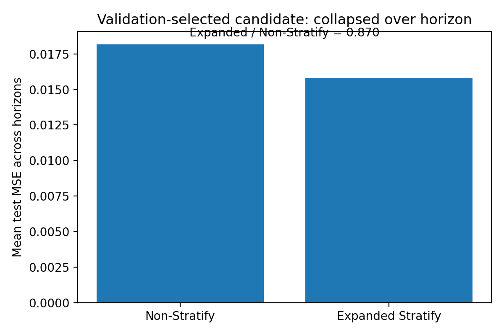
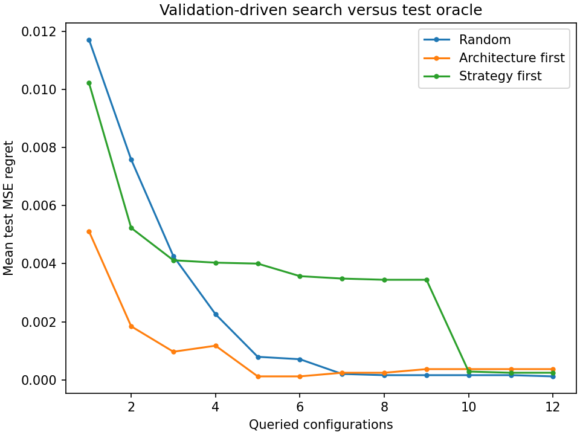
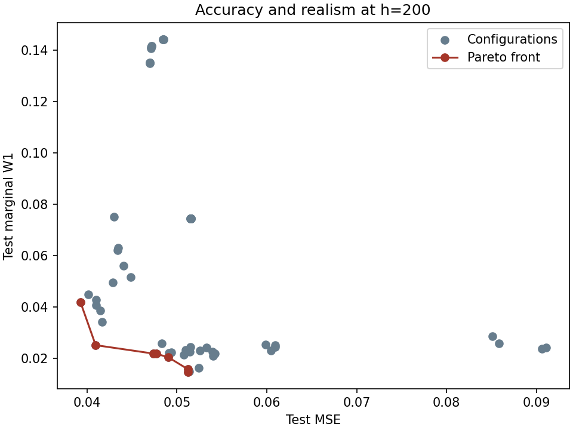

# System Design in Multi-Step Forecasting

Code accompanying the PhD thesis *System Design and Selection for Multi-Step Time Series Forecasting* — Riku Green, University of Bristol (2026).

Multi-step forecasting involves more than choosing a predictive model. The forecasting strategy determines how the model produces a future trajectory, while the evaluation objective determines which resulting predictions we prefer.

This repository provides a unified reference implementation for exploring these choices.

## How it works

The framework has two parts:

**Part I — Fit forecasting systems**

Generate a time series, construct combinations of predictive models and forecasting strategies, train them, and save complete horizon-level predictions on training, validation and test data.

**Part II — Analyse the candidate space**

Use those saved predictions to investigate validation-based selection, architecture–strategy interaction, budgeted search, and accuracy–realism trade-offs.

Models are fitted once; different analyses can then be run without retraining.

## Three questions from the thesis

The following examples use a stochastic Mackey–Glass time series with low process noise. They illustrate the methods rather than reproduce the thesis's original benchmark results.

### 1. Does expanding the strategy space help?

Chapter 5 introduces *Stratify*: a framework for constructing forecasting strategies beyond a restricted set of established approaches.

Here, we compare validation-based selection from unrectified RecMO candidates against an expanded space that also includes RecMO–RecMO base–rectifier combinations.

Each candidate is evaluated over the full forecast horizon. The best candidate from each space is selected using validation MSE, then compared on held-out test data.



The example demonstrates how changing the available candidates can change the outcome of model selection. It covers the RecMO–RecMO region, not the complete Stratify space.

### 2. Can we search the architecture–strategy space efficiently?

Chapter 6 studies how model architecture and forecasting strategy interact.

Rather than treating these as independent choices, we evaluate combinations of architectures and RecMO configurations. The resulting performance surface can be used to compare different search procedures under a limited evaluation budget.



This example compares search procedures using the saved candidate evaluations, without training additional models during analysis.

### 3. What if MSE is not our only objective?

Chapter 7 examines the relationship between pointwise accuracy and marginal distributional agreement.

For each forecasting system, we measure both MSE and marginal Wasserstein-1 distance (\(W_1\)). Different systems may offer different trade-offs between these objectives.



The highlighted Pareto frontier shows which evaluated systems are not dominated on both objectives. This is a retrospective analysis of held-out predictions, rather than a validation-selected deployment policy.

## Run the example

Requires Python 3.11+.

```bash
pip install -r requirements.txt
python -m unittest discover -s tests -v
```

**Part I — Train and save forecasts**

```bash
python -m thesis_forecasting.train \
  --config configs/single_task.json \
  --out runs/single_task
```

**Part II — Analyse saved forecasts**

```bash
python -m thesis_forecasting.analyse \
  --bundle runs/single_task \
  --out runs/single_task-analysis
```

For a faster end-to-end check, use `configs/tiny.json`.

The repository also provides `configs/three_noise.json` for comparing low, medium and high Mackey–Glass process-noise settings.

## Scope

This is an evolving reference implementation, not an exact reproduction package for every thesis experiment.

The current release supports Ridge regression, decision trees and MLPs, with RecMO and RecMO–RecMO forecasting constructions. It includes chronological preprocessing, validation selection, interaction and top-k analysis, budgeted search, and MSE–\(W_1\) Pareto and opportunity analysis.

Additional architectures, forecasting strategies, probabilistic inference rules and cross-dataset analyses may be incorporated in subsequent releases.

## Related research

- Green et al. (2025). *Stratify: Unifying Multi-Step Forecasting Strategies*. Data Mining and Knowledge Discovery.
- Green et al. (2026). *Expectations vs. Realities: The Cost of MSE-Optimal Forecasting Under Conditional Uncertainty*. ACM SIGKDD.
- Green (2026). *System Design and Selection for Multi-Step Time Series Forecasting*. PhD thesis, University of Bristol.